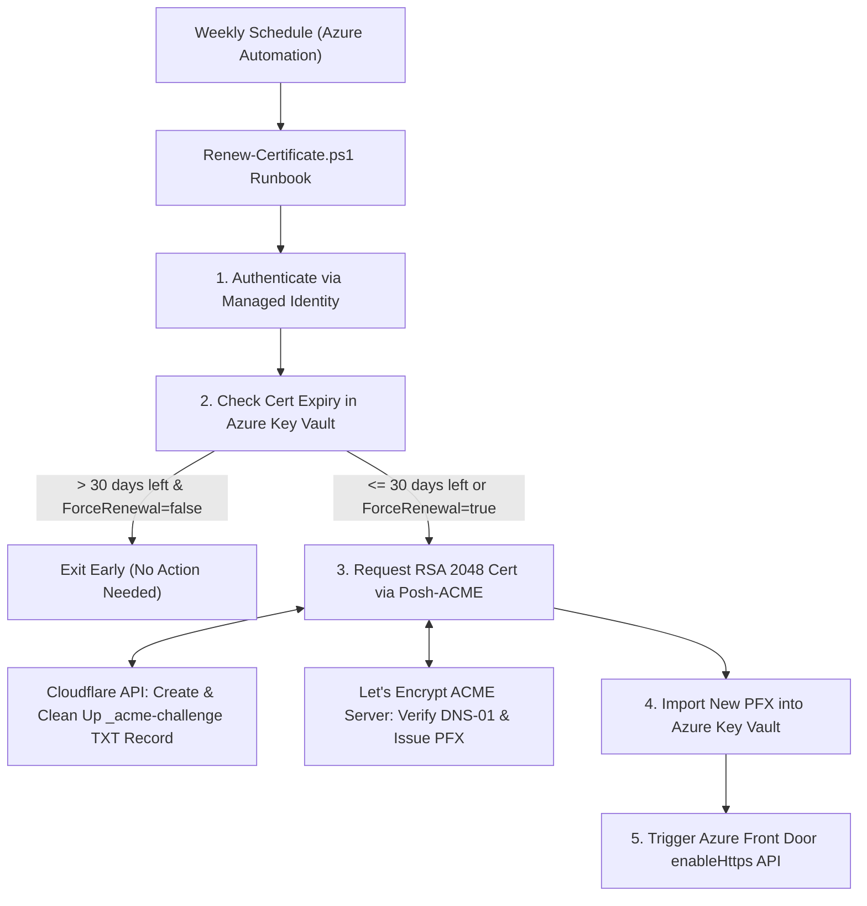

# Automated Let's Encrypt Certificate Renewal for Azure Front Door

Zero-touch, fully automated SSL/TLS certificate renewal for `images.seifbassem.com` running natively in **Azure Automation** using **Let's Encrypt**, **Cloudflare DNS-01**, **Azure Key Vault**, and **Azure Front Door**.

---

## Architecture & Flow

Instead of manually running `certbot`, `openssl`, and `az` CLI commands every 75 days, an **Azure Automation PowerShell Runbook** (`Renew-Certificate.ps1`) runs on a weekly schedule inside Azure:



### Why Check Weekly Instead of Every 75 Days?

Let's Encrypt certificates are valid for **90 days**. By scheduling the runbook to run **weekly** and checking the actual expiration timestamp in Azure Key Vault (`RENEW_WITHIN_DAYS=30`):
- **Weeks 1–8 (> 30 days left)**: The runbook checks Key Vault, sees more than 30 days remaining, and exits in ~10 seconds without calling Let's Encrypt or modifying Front Door.
- **Week 9 (<= 30 days left)**: The runbook automatically renews the certificate, imports it to Key Vault, and updates Front Door.
- **Automatic Retry**: If a transient network or API outage occurs during a renewal run, it automatically retries the following week while still well ahead of expiration.
- **Cost**: Azure Automation includes **500 free job minutes per month**, so this runs at **$0/month**.

---

## Repository Structure

| File | Description |
| :--- | :--- |
| `Renew-Certificate.ps1` | PowerShell Runbook executed inside Azure Automation to check expiry, complete the Cloudflare DNS-01 challenge, import the PFX to Key Vault, and update Front Door. |
| `deploy.sh` | One-command provisioning script that creates/updates the Azure Automation Account, Managed Identity, RBAC/Access Policies, `Posh-ACME` module, encrypted variables, runbook, and weekly schedule. Reads all configuration from environment variables. |
| `../.github/workflows/deploy-cert-renewal.yml` | GitHub Actions workflow that logs in to Azure via OIDC and runs `deploy.sh` with configuration injected from GitHub secrets. |
| `Certificate renewal.md` | Quick summary of the automated setup alongside the original manual CLI steps for emergency fallback. |

---

## Prerequisites

### 1. Local Machine (for one-time deployment only)
- **Azure CLI (`az`)** installed and logged in (`az login`) with permissions to create resources and role assignments in your target Resource Group.
- **`bash`** and **`python3`** (pre-installed on macOS/Linux) used by `deploy.sh` to format ARM REST payloads.

### 2. Existing Azure Resources
- **Azure Key Vault** where the certificate (`images-seifbassem-cert`) is stored.
  > **Note**: Ensure the Azure Front Door service principal already has permission to read secrets/certificates from your Key Vault (already configured if Front Door is currently serving your Key Vault certificate).
- **Azure Front Door (Classic)** with a custom frontend endpoint (`images.seifbassem.com`).

### 3. Cloudflare API Token
Create a scoped API token so Azure Automation can create and delete the `_acme-challenge.images.seifbassem.com` TXT record:
1. Open the [Cloudflare API Tokens Dashboard](https://dash.cloudflare.com/profile/api-tokens).
2. Click **Create Token** → Use the **Edit zone DNS** template.
3. Configure **Permissions**:
   - `Zone` → `DNS` → `Edit`
   - `Zone` → `Zone` → `Read`
4. Configure **Zone Resources**:
   - `Include` → `Specific zone` → `seifbassem.com`
5. Click **Continue to summary** → **Create Token**, and copy the generated token string.

---

## Step-by-Step Configuration & Deployment

### Step 1: Create GitHub Secrets

Sensitive configuration is stored as **GitHub Actions secrets** (Settings → Secrets and variables → Actions). No `.env` or config file is used.

| Secret | Description |
| :--- | :--- |
| `AZURE_CLIENT_ID` | Client ID of the Entra ID app / user-assigned identity with an OIDC federated credential for this repo |
| `AZURE_TENANT_ID` | Entra ID tenant ID |
| `AUTOMATION_ACCOUNT_NAME` | Automation Account name |
| `KEY_VAULT_NAME` | Key Vault name |
| `KEY_VAULT_CERT_NAME` | Certificate name in Key Vault |
| `FRONT_DOOR_NAME` | Front Door (Classic) name |
| `FRONT_DOOR_ENDPOINT_NAME` | Front Door frontend endpoint name |
| `ACME_CONTACT_EMAIL` | Let's Encrypt account contact email |
| `CLOUDFLARE_API_TOKEN` | Scoped Cloudflare token (see above) |

The following non-sensitive values are stored as **GitHub Actions variables** (Settings → Secrets and variables → Actions → **Variables** tab):

| Variable | Description |
| :--- | :--- |
| `AZURE_SUBSCRIPTION_ID` | Target subscription ID |
| `AZURE_RESOURCE_GROUP` | Resource Group containing the Automation Account and Front Door |
| `KEY_VAULT_RESOURCE_GROUP` | Resource Group containing the Key Vault |

`CERT_DOMAIN`, `ACME_SERVER`, and `RENEW_WITHIN_DAYS` are set directly in the workflow file. The Automation Account location defaults to the location of `AZURE_RESOURCE_GROUP` (override by setting `AZURE_LOCATION`).

> **Azure identity permissions**: the OIDC identity needs **Contributor** **plus** permission to create role assignments (**User Access Administrator** or **Role Based Access Control Administrator**) on both `AZURE_RESOURCE_GROUP` and the Key Vault (or `KEY_VAULT_RESOURCE_GROUP`). The federated credential must be of type **Branch** = `main` (subject `repo:sebassem/myBlog:ref:refs/heads/main`), so the workflow must run from `main`.

### Step 2: Run the Deployment Workflow

The **Deploy Certificate Renewal Automation** workflow runs automatically on pushes to `main` that change `deploy.sh` / `Renew-Certificate.ps1`, or manually from the **Actions** tab (`workflow_dispatch`).

To run locally instead, `az login` and `export` the same variables in your shell before running `./deploy.sh`.

#### What `deploy.sh` Does Automatically:
1. **Automation Account**: Creates (or updates) the Automation Account with a **System-Assigned Managed Identity**.
2. **PowerShell Module**: Imports `Posh-ACME` from the PowerShell Gallery into the Automation Account.
3. **Permissions**:
   - Detects whether your Key Vault uses **Azure RBAC** or **Vault Access Policies** and grants the Managed Identity either the `Key Vault Certificates Officer` role or `get/list/import/update` certificate & secret permissions.
   - Assigns `Network Contributor` to the Managed Identity on your Front Door resource.
4. **Automation Variables**: Stores all configuration values in Azure Automation and marks `CloudflareApiToken` as **encrypted** at rest.
5. **Runbook**: Uploads and publishes `Renew-Certificate.ps1`.
6. **Schedule**: Creates a weekly recurring schedule (`Weekly-Cert-Renewal-Check`) and links it to the runbook.

---

## Testing & Verification

After the deployment workflow succeeds, wait **~2 minutes** for Azure Automation to finish importing the `Posh-ACME` module from the PowerShell Gallery.

### 1. Test the Expiry Check (Dry Run)
Start the runbook with default parameters. If your current certificate in Key Vault has more than 30 days left, it will verify Key Vault connectivity and exit without issuing a new certificate:

```bash
az automation runbook start \
  --automation-account-name "<your-automation-account>" \
  --resource-group "<your-resource-group>" \
  --name "Renew-Certificate"
```

### 2. Force an Immediate Certificate Renewal
To test the full flow (Cloudflare DNS-01 challenge → Key Vault PFX import → Front Door HTTPS update) right away, pass `ForceRenewal=true`:

```bash
az automation runbook start \
  --automation-account-name "<your-automation-account>" \
  --resource-group "<your-resource-group>" \
  --name "Renew-Certificate" \
  --parameters ForceRenewal=true
```

> **Tip**: If you want to test the ACME challenge without counting against Let's Encrypt production rate limits, pass `--parameters ForceRenewal=true AcmeServerOverride=LE_STAGE` (note: a staging certificate is not browser-trusted, so follow up with a production run afterward).

### 3. View Job Logs in Azure Portal
1. Open the **Azure Portal** → **Automation Accounts** → your Automation Account.
2. In the left menu, go to **Process Automation** → **Jobs**.
3. Click the most recent job and view the **Output** tab to inspect each step (`[Step 1/5]` through `[Step 5/5]`).

---

## Updating Configuration Later

If you ever rotate your Cloudflare API token or change any value, update the GitHub secret and re-run the **Deploy Certificate Renewal Automation** workflow from the Actions tab.

`deploy.sh` is fully idempotent—it updates the Automation Variables, runbook code, and schedule in place without duplicating resources.
